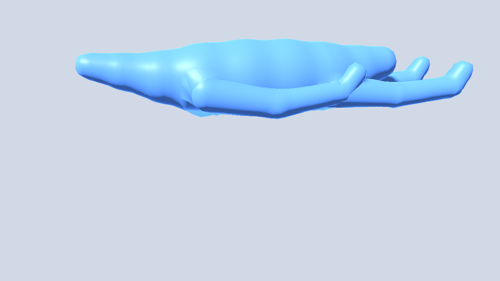

# Legless and stub-leg Gait Lab report

Status: PROPOSED prototype. This is original Godot 4.7.2 work based on the project's
creature descriptions. It is not production locomotion or a dynamics simulation.

## Method

The spine-only `s1_snake` uses a head-to-tail travelling yaw wave at 1.25 Hz, 1.25
waves along the body and 8 degrees per vertebra. Alternating brief belly contacts
approximate ground traction. Its commanded maximum speed uses capped body length
and vertebra count. The two-joint short-legged `s1_tiny` uses alternating paired
leg lifts at 2 Hz and a conservative translational and turning limit. Each stance
foot now holds a world-space anchor while the swing foot lifts and moves toward
its next landing point. The existing
generated `SpineRig` supplies the mesh and bones; the new adapter applies the poses.

`tests/ground_drive_checks.gd` runs both descriptions for 3,600 steps at 60 Hz
with the existing deterministic `random` drive seed 17. It checks finite positions,
orientation, velocity, phase and contact anchors; nonzero travel; maximum contact
slip; and root pitch/roll. Contact slip is maximum displacement of a nominal
planted belly point or foot from its position at contact onset, divided by body
length or short-leg length. It includes turns. The flat-ground controller holds
the root level by design; pitch and roll now come from the posed root transform
each step. A deliberate 6-degree pitch fails the 5-degree gate while the level
root passes. This is a kinematic gate, not dynamic tipping under gravity.

The 12% belly and 25% foot limits are **PROPOSED prototype tolerances**, not
biomechanical measurements. They normalize motion to body and stub-leg length:
12% permits short travelling-wave belly contacts while detecting a lost anchor;
25% permits the stub's small turning reach while catching a sliding planted foot.

## Headless measurements

Godot 4.7.2 stable, Windows headless, `tests/run_tests.gd`:

| Check | Result | Gate |
| --- | ---: | ---: |
| Slither maximum at 1 m / 8 vertebrae | 0.093 m/s | Increasing |
| Slither maximum at 2 m / 8 vertebrae | 0.186 m/s | Increasing |
| Slither maximum at 2 m / 20 vertebrae | 0.286 m/s | Increasing |
| Slither cap at extreme size/count | 0.550 m/s | At most 0.550 m/s |
| Snake 60 s absolute travel | 12.874 m | Nonzero |
| Snake maximum nominal belly slip | 8.46% of body length | At most 12% |
| Tiny 60 s absolute travel | 0.175 m | Nonzero |
| Tiny maximum posed stance-foot slip | 0.00% of short-leg length | At most 25% |
| Tiny maximum swing travel over ground | 0.0086 m | Above 0.005 m |
| Both 60 s state/pitch/roll | Finite, 0 degrees | Finite, at most 5 degrees |

These are controller and posed-joint measurements, not terrain interaction or
physical friction. The earlier 19.27% figure tracked a fixed body-frame rest
point sliding under the body, not a planted foot. The tiny body's maximum speed
is intentionally low given its short reach. A later dynamics pass should verify
traction and balance on slopes and uneven ground, and visual review should check
wave and skin appearance in the full renderer.

## Hip swing follow-up

Reducing limb-dominant vertices' competing spine influence from 0.10 to 0.02
improves the `s1_quadruped` 90-degree hip cross-section. The headless test now
requires hip radius at least 0.80, knee radius at least 0.90, and hip and knee
field error at most 0.08 of body length at 0, 45 and 90 degrees.

| Swing | Hip radius before | Hip radius after | Knee radius after | Hip error after | Knee error after |
| --- | ---: | ---: | ---: | ---: | ---: |
| 0° | 1.000 | 1.000 | 1.000 | 0.0039 | 0.0021 |
| 45° | 0.881 | 0.973 | 1.000 | 0.0311 | 0.0021 |
| 90° | 0.767 | 0.946 | 1.000 | 0.0740 | 0.0602 |

The Stage-1 `s1_biped` combined 60-degree spine bend / 30-degree limb swing
posed-surface error rises from 2.07% on `main` to 3.48% here. This remains below
the existing 5% gate, but is a visual review tradeoff.

OpenGL Compatibility screenshots from pinned Godot 4.7.2 on an NVIDIA RTX 5070,
with the same body, camera and 90-degree hip pose:

## Verification

`tests/run_tests.gd`, `run_legless_tests.gd`, `run_skin_volume_tests.gd`,
`run_spine_tests.gd`, `run_stage1_tests.gd` and `run_editor_tests.gd` all ended
with `FAILURES: 0`. The main game suite passed 637/637 after import. Headless scene smoke runs of
`walker_lab.tscn` with `s1_snake` and `s1_tiny` loaded without script errors.
`run_stage1_tests.gd` still reports its existing known `s1_tiny` posed-surface
miss, which is outside this gait change.
