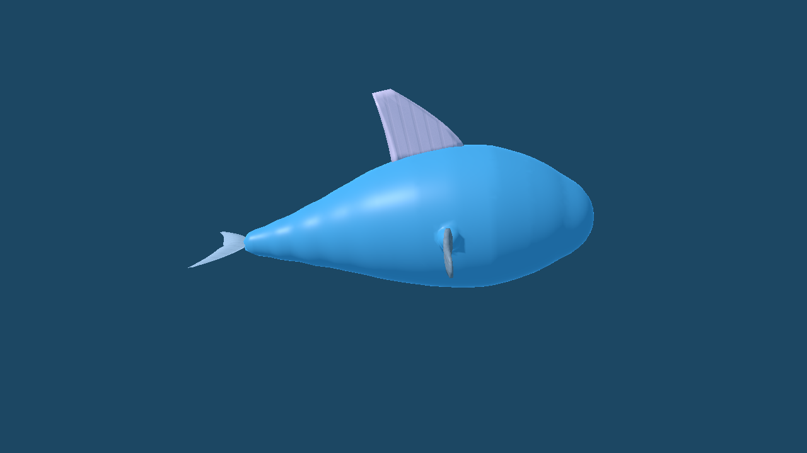
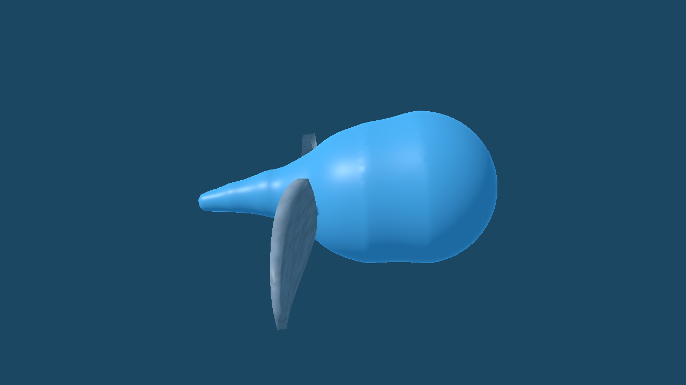

# Swim Gait Lab

Status: **PROPOSED** prototype. This is an original Godot 4.7.2 kinematic
experiment in `prototypes/creature-lab/`, with no game integration.

## Selection and body-derived motion

`SwimDrive.aquatic()` chooses water when the body description has a fin,
flipper or tail fluke and no ground-reaching limb. `--medium=water` explicitly
overrides that test. The lab selects swim before the legged gait and ground
drive. A swimmer has no foot targets, stance, friction, gravity or `GroundDrive`.
The root stays at its starting depth under neutral buoyancy.

The two PROPOSED sample descriptions are derived from the lab's existing fish
and tadpole spines. `swim_tail` adds a tail fluke, dorsal fin and paired flippers;
`swim_fins` adds paired flippers and no tail paddle. No controller constant is
selected by either body name. For each body, the controller sums vertebra
separations for length *L*, counts paired fins, and derives a speed ceiling
`clamp(0.32 L + 0.06 fin_count, 0.12, 0.65)` m/s. A complete stroke's
frequency is `clamp(speed / (0.55 L), 0.45, 2.0)` Hz. Desired speed changes
the rate at which phase advances. A tail body's relative joint yaw is a
head-to-tail travelling sine with amplitude rising from 20% near the head to
100% at the tail. Its amplitude is `clamp(5 + 5/L, 7, 14)` degrees. The paired
flippers rotate in opposite phase on that same cycle. With paired fins and no
tail paddle, the spine wave is zero and only those flippers stroke.

Root pitch follows commanded forward/reverse travel by at most 4 degrees;
root roll follows turns by at most 4 degrees. The posed transform is sampled
each step, and the same 5-degree pitch/roll gate used by the ground drive
must pass. There is no foot-slip measurement in water. The skin volume runner
from the #75 follow-up remains part of the verification set.

## Bounded headless checks

Pinned Godot 4.7.2 stable on Windows, 600 steps at 60 Hz, throttle 1.0 and
turn 0.25. The progress check requires the forward projection of each
completed cycle to exceed 0.02 m. The curvature check divides the largest
relative joint yaw by mean vertebra spacing and requires less than 2 rad/m.
These are PROPOSED lab gates, not measured animal limits.

| Description | Mode | Speed ceiling | Stroke frequency | Minimum cycle progress | Maximum curvature | Max pitch / roll |
| --- | --- | ---: | ---: | ---: | ---: | ---: |
| `swim_tail` | tail wave + fins | 0.469 m/s | 0.945 Hz | 0.491 m | 1.835 rad/m | 4.00° / 1.00° |
| `swim_fins` | paired fins only | 0.201 m/s | 1.446 Hz | 0.137 m | 0.000 rad/m | 4.00° / 1.00° |

The two runs also assert identical 600-step states from identical descriptions
and inputs, finite positions, actual flipper-bone motion and zero ground
contacts. The explicit water override selects swimming even for a legged
body; ordinary ground-reaching legs keep their gait. Deliberately pitching the
root 6 degrees fails the 5-degree gate, confirming it can reject a pose.

## Rendered side views

The images show a quarter-cycle pose viewed at 90 degrees to the forward
axis, captured at 1280×720 with pinned Godot 4.7.2, OpenGL Compatibility on
an NVIDIA RTX 5070. They show the generated skin and original lab part GLBs.

## Limits and open questions

The controller **scripts translation from a speed command**. Neither the
travelling wave nor the fin stroke creates hydrodynamic thrust; neutral
buoyancy is a fixed depth. Water drag, lift, steering torque, collision,
energy cost and skin behavior in a rendered game world still need validation.
The side views show appearance at one phase, not a measured animation clip.

## Verification

Pinned Godot 4.7.2 `tests/run_swim_tests.gd` and all six existing lab runners
(`run_tests.gd`, `run_legless_tests.gd`, `run_skin_volume_tests.gd`,
`run_spine_tests.gd`, `run_stage1_tests.gd`, `run_editor_tests.gd`) each ended
with `FAILURES: 0`. Short headless `walker_lab.tscn` loads of both presets and
`--body=all` exited 0. The main game's headless suite passed 643/643 after
import. OpenGL Compatibility screenshots were captured and inspected on
Windows; the Linux `xvfb-run` command in `docs/TOOLCHAIN.md` is unavailable
on this host.

Should speed be capped by fin area and muscle energy in a later aquatic
prototype? Should the fin-only mode use a recovery stroke with asymmetric
drag? Both remain PROPOSED research questions.
