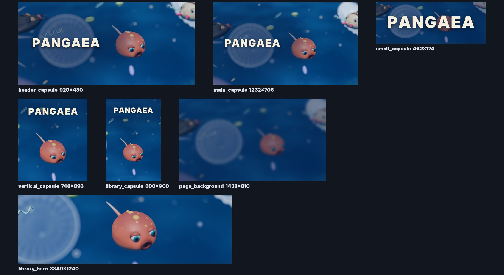

# Capsule art concepts

**Status: PROPOSED concepts.** Not final art and not uploaded anywhere. The wordmark is a placeholder until the name
is settled.



## How they are made

1. `tools/blender/render_store_keyart.py` renders two text-free key art masters from the approved microscopic-world
   mood scene (`render_micro_mood.build`): the production player cell, the step 3 threats, food and the glassy
   shells, all Blender-authored. The hero cell turns its face to a lower, closer camera than play.
   - `keyart/keyart_wide.png`: 16:9; the cell sits right of centre and the left third stays calm for the logo.
   - `keyart/keyart_tall.png`: 2:3; the cell sits low and the top third stays calm for the logo.
2. `tools/store/make_capsules.py` crops the masters to every Steam size, darkens softly behind the logo and sets the
   placeholder wordmark (Inter Display Black, SIL OFL 1.1). It writes `capsules/*.png` and the contact sheet above.
   It needs Pillow, which is marketing tooling only and never part of the game.

```bash
python tools/blender/render_store_keyart.py --scale 100 --samples 96   # finals; the concepts used --scale 50 --samples 40
python tools/store/make_capsules.py --name "PANGAEA"
```

The committed masters are rendered at 50% scale (1920x1080 and 1080x1620) on the cloud CPU, so the library hero
(3840x1240) is upscaled and soft. Before upload, render the masters at 100% on a machine with a GPU.

## Sizes (checked 2026-10-23)

| File | Size | Where it shows | Text allowed |
| --- | --- | --- | --- |
| `header_capsule.png` | 920x430 | Store page top, recommendations | Title only |
| `small_capsule.png` | 462x174 | Search and lists (also scaled to 184x69 and 120x45) | Title only; logo nearly fills it |
| `main_capsule.png` | 1232x706 | Front page carousel | Title only |
| `vertical_capsule.png` | 748x896 | Seasonal sales and events | Title only |
| `page_background.png` | 1438x810 | Store page backdrop (optional) | None; kept dark and soft |
| `library_capsule.png` | 600x900 | Steam library grid | Title only |
| `library_header.png` | 920x430 | Steam library (falls back to the header capsule) | Title only |
| `library_hero.png` | 3840x1240 | Steam library game page banner | **None**; keep the subject in the central 860x380 |
| `library_logo.png` | up to 1280x720, transparent | Over the library hero | Logotype only |

## What a final pass needs (art department)

- **The name and a real logotype.** A designed wordmark (custom letterforms, perhaps a small cell logomark), not a
  typed font. It must read at 120x45 in the small capsule.
- **A stronger story in the frame.** The concepts show the hero cell alone with threats at the edges. A final key art
  could stage a moment: the cell turning to face a looming ambush hunter, or a lineage of three generations.
- **Full-resolution renders** at 100% scale on a GPU, plus a dedicated 3.1:1 library hero framing with the cell
  centred, instead of a crop of the 16:9 master.
- **The endless-world look.** When the endless cell stage lands, re-stage the key art in it with its landmarks.
- Steam judges capsules at thumbnail size: check each at 25% before upload.
